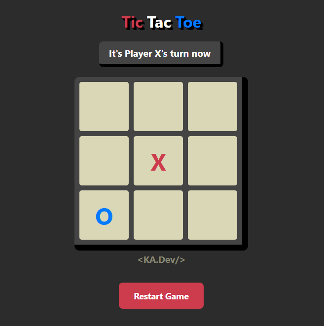
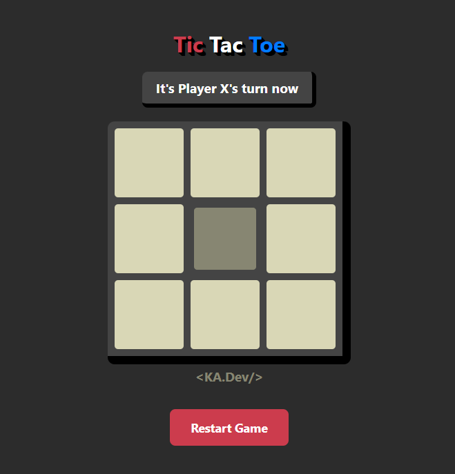
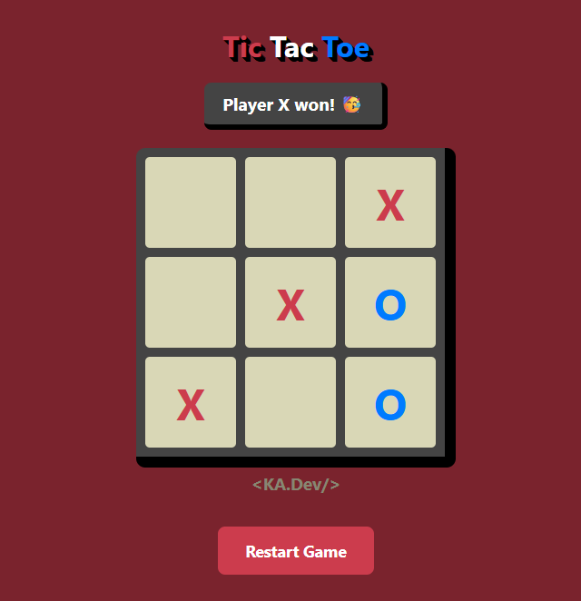
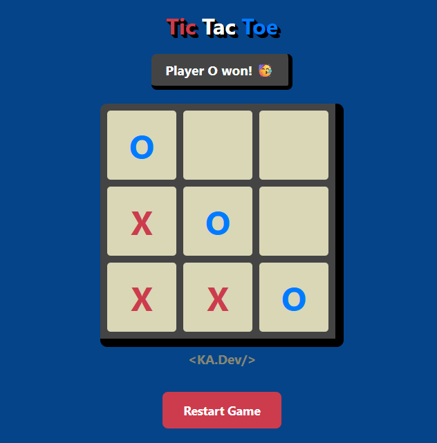

# Tic Tac Toe

> A simple Tic Tac Toe game to demonstrate some knowledge of HTML, CSS, and JavaScript

I built this game as a way to demonstrate my fundamental web development skills.

## Preview

Here is how it looks: 

## Features

- **Classic Gameplay:** Play against a friend locally.
- **Visual Feedback:** Smooth hover animations on the board and buttons.
- **Player Colors:** X is red, O is blue, making it easy to track whose turn it is.

## Author

**KA.Dev**
- GitHub: [@KaueAlves-KA](https://github.com/KaueAlves-KA)